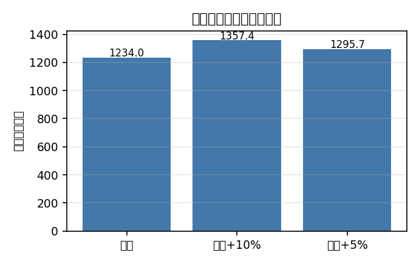
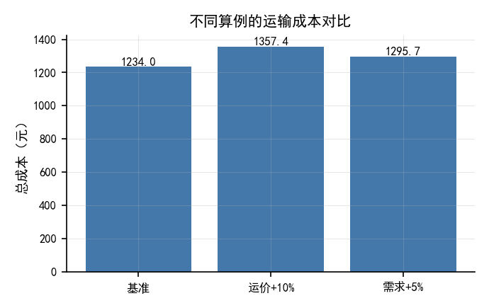

# 视觉校验发现的问题（为什么"测试全绿"不等于"产物可用"）

> 本轮做了一件之前没做的事：**把生成出来的 PDF 渲染成图，自己看一遍**。
> 结果在 395 项测试全绿的情况下，发现了 **4 个只有看图才能发现的缺陷**。

---

## 0. 结论

| 检查手段 | 能发现 | 发现不了 |
|---|---|---|
| 单元测试 | 逻辑、契约、边界 | 渲染结果是否正确 |
| 编译返回码 | 是否报错 | 内容是否被**静默截断** |
| 文件存在 + 尺寸 | 有没有产出 | 中文是否变成方框 |
| **人看/模型看图** | **上面全部** | — |

**"测试全绿 + 编译成功 + 文件存在"三者同时成立，产物仍然可能是不可用的。**
本轮的 4 个缺陷就是例证。

---

## 1. 缺陷一：编译失败被误报为成功（最严重）

### 现象
导出报告 `ok: True`、PDF 82392 字节、2 页——**看起来完全正常**。

### 真相
把 PDF 渲染出来一看：**正文第 2 页之后就没了**——程序生成的表格、图、参考文献全部缺失。

追查 `.tex` 发现它们**明明在里面**（L92-137）。查编译日志：

```
! Unable to load picture or PDF file 'figures/fig_scenarios.png'.
The requested image couldn't be read because it was not a recognized image format.
l.131 ...[width=14.0cm]{figures/fig_scenarios.png}
```

### 根因（两层）
1. **路径错误**：`\includegraphics` 的路径**相对于 `.tex` 文件**。
   图在 `<ws>/figures/`，`.tex` 在 `<ws>/paper/`，所以需要 `../figures/...`。
   我写成了 `figures/...` → 解析到 `<ws>/paper/figures/` → 不存在。
2. **判定过宽**：`ok = pdf.is_file() and (returncode == 0 or size > 0)`。
   `size > 0` 让"中途报错、只输出前 2 页"这种情况被报成了成功。

### 修复
```python
# 判定必须严格
ok = p.returncode == 0 and pdf.is_file()

# 图路径按相对 .tex 的位置计算（不写死 "../"）
rel = os.path.relpath(str(ws.resolve()), str(paper_dir.resolve()))
figure_base = "" if rel == "." else rel.replace("\\", "/") + "/"
```

**修复后：2 页 → 4 页**，表格/图/参考文献全部出现。

> **教训**：`size > 0` 这种"宽松判据"是危险的反模式。
> 它把失败伪装成成功，而成功的外观会让人停止追查。

---

## 2. 缺陷二：正文里的 Markdown 表格没被转换

### 现象
"4 符号说明" 一节显示成：

```
|符号|含义|
|---|---|
|$x_{ij}$|从仓库 $i$ 运往配送点 $j$ 的运量| ...
```

**表格源码被当成正文原样打印。**

### 根因
`markdown_body_to_tex` 只处理了列表与行内标记，**没有处理表格**。

### 修复
新增表格识别（`|` 行 + 分隔行）与 `_md_table_to_tex`（booktabs 三线表），
并把所属章节标题作为表题，使表格**参与 LaTeX 自动编号**。

修复后该表正确渲染为三线表，`$x_{ij}$` 等公式也正常。

---

## 3. 缺陷三：图表里的中文全是方框

### 现象
数据图的坐标轴标签显示为 `□□`、`□□+10%`、`□□+5%`——
**这张图在中文论文里完全不可用。**

| 修复前 | 修复后 |
|---|---|
|  |  |

### 根因
matplotlib 默认字体是 **DejaVu Sans，不含 CJK 字形**：

```
UserWarning: Glyph 38656 (\N{CJK UNIFIED IDEOGRAPH-9700}) missing from font(s) DejaVu Sans.
```

另外 `axes.unicode_minus=True`（默认）会让负号也变方框。

### 修复
新增 `services/figure_style.py`：

- 自动挑选可用中文字体（SimHei / Microsoft YaHei / …）并置于字体族首位；
- **关闭 `unicode_minus`**；
- 提供论文风格预设（小字号、细线、去顶/右边框）；
- `save_figure()` **自检是否缺字形**——用 `warnings` 捕获 `missing from font`，
  一旦命中就抛错，**阻止"看起来成功、实际是方框"的图落盘**。

> **这是本轮最有价值的发现**：它也正是蓝方专门做
> `data_fig_vision_check.py` / `tikz_vision_check.py` 的原因——
> **图表的问题必须靠"看"来发现**。
> 蓝方的 docstring 里还记录了另一条相关教训：vision 自检若"非 PASS 即 FAIL"，
> 几何图必然被判失败、每张烧满 2 轮重编，是"画完卡很久"的根因；
> 他们后来把它**降级为非阻塞加分项**。这个取舍是对的。

---

## 4. 缺陷四：图注是文件路径

### 现象
`图 1  figures/fig_scenarios.png` —— 图注直接用了文件路径，对论文毫无意义。

### 根因
`caption` 为空时 fallback 到了 `self.path`。

### 修复
三级兜底：**显式 caption → `FIGURE_MANIFEST` 的章节名 → 可读名**
（`fig_scenarios` → `scenarios`）。修复后显示 `图 1 结果与讨论`。

---

## 5. 最终产物

修复后重新生成，4 页，全部内容正确：

| 页 | 内容 | 校验点 |
|---|---|---|
| 1 | 标题 + 摘要 + 关键词 | 中文正常、标题 18pt 居中、摘要首行缩进、关键词 SimHei |
| 2 | 正文 + 符号说明表 | **三线表正确**、公式正常 |
| 3 | 求解结果 + 程序化表格 + 参考文献 | **表 1/表 2 为三线表，数值与 `all_results.json` 逐字一致**；参考文献悬挂缩进 |
| 4 | 数据图 | **中文坐标轴正常**、图注可读 |

完整页图：[page1](assets/paper-page1.png) · [page2](assets/paper-page2.png) ·
[page3](assets/paper-page3.png) · [page4](assets/paper-page4.png)

---

## 6. 已固化为回归测试

本轮修复全部转成了测试，防止回退（`tests/test_typesetting.py` 新增 4 组、21 项）：

| 测试 | 防止什么 |
|---|---|
| `test_compile_success_criterion` | **引用了缺失图片必须报失败**；未知命令必须报失败 |
| `test_markdown_table_conversion` | 正文表格不得残留管道符源码；必须生成 caption |
| `test_figure_path_and_caption` | 图路径必须带正确前缀；图注不得是路径 |
| `test_figure_style_cjk` | 中文字体必须应用；`unicode_minus` 必须关闭；**含中文的图必须能保存且无缺字形告警** |

> 其中 `test_compile_success_criterion` 是直接针对"最严重缺陷"写的：
> 它构造一个引用不存在图片的 `.tex`，**断言编译必须失败**。
> 如果将来有人再把判据放宽，这个测试会立刻失败。

---

## 7. 可复现

```bash
PY="E:/02_Installers/DailyApps/Modex-MH-Agent/runtime/python/python.exe"
cd modemon/backend

# 生成论文并渲染成图（供人查看）
"$PY" render_paper_preview.py

# 生成中文缺字形的前后对比图
"$PY" make_tofu_demo.py

# 成文链测试（含本轮新增的回归项）
"$PY" tests/test_typesetting.py
```

---

## 8. 方法学总结

**该在什么时候"看一眼"？**

- 任何**有视觉形态**的产物：PDF、DOCX、图表、排版、前端界面；
- 特别是**跨了工具链**的产物（Markdown → LaTeX → PDF，或 → DOCX），
  每一层转换都可能静默丢内容；
- 尤其是**当你的成功判据里出现了 `size > 0`、`exists()` 这类宽松条件**——
  那正是需要亲眼确认的信号。

本轮 395 项测试没有发现这 4 个问题；**看 4 张图，5 分钟就全找到了。**
